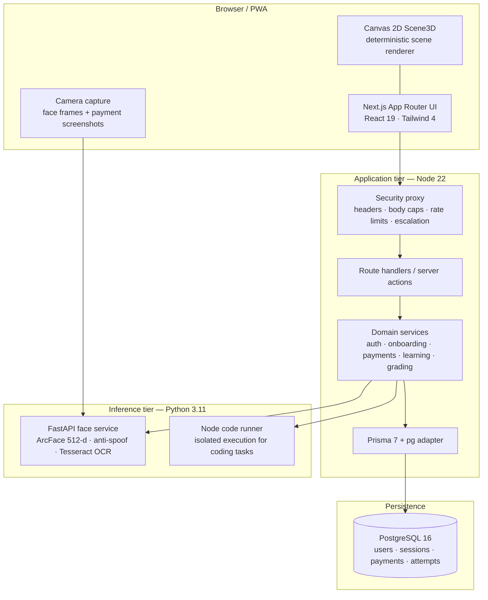

<div align="center">

# LEOU — Advance Learning Platform

**Identity-verified, entitlement-aware learning infrastructure for mathematics,
computing and chemistry — engineered for the Indian classroom, designed to a
global standard.**


</div>

---

## Executive summary

LEOU is a production learning platform that combines **biometric identity**,
**manual UPI commerce**, **entitlement-gated courses**, and an **interactive 3D
concept engine** in one deployable system.

It is not a static content site and it is not a generic LMS. The hard problems
here are *trust* (who is actually behind the camera), *entitlement* (what this
student has paid for, down to the chapter), and *explanation* (how to make an
abstract idea like electronegativity or binary fractions manipulable instead of
merely readable). Those three concerns shape every layer of the codebase.

The platform is deliberately polyglot: a Next.js/TypeScript application for
product logic, a Python/FastAPI service for face and OCR inference, a small Node
runtime for untrusted code execution, SQL migrations as the source of truth for
schema, and Bash for orchestration.

---

## 1. Thesis and problem space

A tuition platform in this environment has to work under conditions that most
Western ed-tech products never model:

- **Shared devices.** Accounts are often accessed from a family phone or a
  computer at a coaching centre. Password-only login is not sufficient evidence
  of identity.
- **Offline-ish payments.** UPI is universal, but payment gateways are not. Money
  arrives before any webhook does, so the system must treat *proof* as a first-
  class object rather than assuming a provider callback.
- **Granular entitlements.** A student may have purchased Physics and Chemistry
  but not Mathematics; within Chemistry, one chapter may be included and another
  not. Access control therefore has to resolve at the **subject → batch → topic**
  level, not at a single "pro user" flag.
- **Conceptual teaching.** CBSE and JEE reward reasoning, not recall. The learning
  layer needs manipulable models, not PDFs.

The architecture below is a direct response to those constraints.

---

## 2. System at a glance



The web tier and the inference tier are separate processes behind one entrypoint.
The web app refuses to serve until the face service reports ready, so the first
student who signs up after a restart never absorbs model load time.

---

## 3. Core domains

### 3.1 Identity and trust

- **Face enrolment** captures five quality-gated samples and stores 512-dimensional
  L2-normalised ArcFace embeddings (InsightFace `buffalo_l`). A live login captures
  three frames and requires a majority match against the enrolled set; cosine
  distance thresholds are explicit and documented in `src/lib/constants.ts`.
- **Liveness** is handled by DeepFace anti-spoofing inside the Python service, not
  by a cosmetic blink animation in the browser.
- **Sessions** are hybrid: an HS256 JWT in an `httpOnly`, `sameSite=lax` cookie plus
  a database-backed session row holding a SHA-256 hash of the raw token. Sessions
  slide forward while in use and can be revoked individually or wholesale.
- **Short-lived credentials** are used for sensitive transitions: 6-digit access
  codes valid for 60 seconds, and 15-digit service codes valid for seven days and
  redeemable for one 30-day service period. Every issuance is written to the
  activity log.
- **Recoverable display passwords** are encrypted with AES-256-GCM using a key
  derived through scrypt from `JWT_SECRET`. Production refuses to derive that key
  from a known default. Login itself still uses bcrypt — the encrypted copy is
  display-only.

### 3.2 Commerce and entitlement

There is no payment gateway in the critical path. A student pays by UPI and proves
it with a transaction ID, a screenshot, or a camera scan of the payment screen.
OCR extracts the reference from the screenshot so a student does not have to type
a 12-digit number.

The service catalogue is configured per **class → batch → subject → item**, with
assignment/mock/test rates stored independently. Entitlement checks reuse the
same helpers that guard assessments and practicals, so a course cannot drift out
of sync with the billing rules. The free General Organic Chemistry course is an
explicit exception: it bypasses entitlement entirely, including for students who
never purchased Chemistry.

### 3.3 Assessment and practical work

- Question types: multiple choice, short answer, long answer, coding, SQL, oral,
  and photo upload.
- Assessment kinds: assignment, mock test, and real test, with release/evaluate
  workflows for administrators.
- Coding tasks run in a separate Node runner with support for Python, JavaScript,
  Java, C++, C and Rust; SQL tasks support MySQL, PostgreSQL and SQLite dialects.
- Practical assignments, doubt threads, screen recordings and per-student
  activity traces are first-class entities rather than attachments to a grade.

### 3.4 Games as training

Chess is not decoration. The platform ships an engine, lesson ladders for physical
and programming levels, invite-based matches, and a training harness that turns
opening and endgame ideas into executable exercises.

---

## 4. The 3D learning engine

`src/lib/learning3d/` contains a small, deterministic rendering model:

- `scene.ts` / `scenes.ts` define the shared scene contract.
- `chemScenes.ts` builds chemistry scenes as **pure functions of control state** —
  bond length, electronegativity, substituent, mechanism step, stereochemistry.
- `chemCourse.ts` and `haloCourse.ts` hold 22 General Organic Chemistry and 18
  Haloalkanes/Haloarenes concepts; `encodingCourse.ts` holds 24 computing concepts.
- `ChemistryCoursePlayer.tsx` and `EncodingCoursePlayer.tsx` drive the UI.

Design decisions worth calling out:

1. **Canvas 2D, not WebGL.** The renderer produces depth, rotation and perspective
   with ordinary canvas primitives. There is no `three.js` dependency and no GPU
   requirement, which matters on inexpensive phones.
2. **Content is static TypeScript.** No schema, no rows, no writes. Progress lives
   in `localStorage`. Adding a concept is a code change, not a migration.
3. **Live values under the model.** Each concept exposes a `live(state)` function
   so the text beside the scene recalculates bond energy, distance or conversion
   result as the student moves a control.
4. **Entitlement is resolved server-side.** The catalogue returns only courses the
   student may actually open; the client never decides access.

| Course | Concepts | Gate | Intended learner |
|---|---:|---|---|
| General Organic Chemistry | 22 | Free for every student | CBSE + JEE |
| Haloalkanes & Haloarenes | 18 | Class 12 CBSE Chemistry availed | CBSE + JEE |
| Encoding Schemes & Conversions | 24 | Class 11 CBSE Computer Science availed | CBSE |

---

## 5. Security posture

Security is treated as a system property, not a middleware afterthought.

| Concern | Mechanism |
|---|---|
| Request abuse | Proxy-level body caps, rate limiting, escalating lockout |
| Session forgery | DB-backed session rows, hashed raw tokens, JWT verification, revocation |
| Brute force | Login and service-code lockouts with activity logging |
| Biometric spoofing | 512-d ArcFace matching plus anti-spoofing, multi-frame majority vote |
| Secret exposure | Real values only in git-ignored `.env`; safe `.env.example` committed |
| Password display | AES-256-GCM with scrypt-derived key; production refuses known defaults |
| Untrusted code | Separate runner process with structured session lifecycle |
| Supply surface | Vendored Monaco assets pinned in `public/vendor/`, no runtime CDN |

---

## 6. Data architecture

`prisma/schema.prisma` and the migrations under `prisma/migrations/` are the
canonical schema. Prisma 7 runs through the `pg` driver adapter rather than a
generated binary engine. The model is organised around a small number of
aggregates:

- **Identity:** `User`, `StudentProfile`, `ParentProfile`, `Session`, `Enrollment`.
- **Catalogue:** `Class`, `Batch`, `Subject`, `OnboardingService`, pricing rows.
- **Commerce:** `PaymentRequest`, `Payment`, `ServiceCode`, `ActivityLog`.
- **Learning:** `Assessment`, `Question`, `Attempt`, `PracticalAssignment`,
  `PracticalDoubt`, `Recording`.
- **Games:** `ChessMatch`, `ChessTraining`, per-game progress.

Migrations are deliberately excluded from the runtime image and applied as a
separate deploy step, keeping the serving image small.

---

## 7. Technology surface

The repository is intentionally polyglot. Each language owns a real layer:

| Language / format | Role in the system |
|---|---|
| **TypeScript** | Application logic, domain services, 3D course content, React UI, test harnesses |
| **Python** | Face embeddings, anti-spoofing, payment OCR, FastAPI inference service |
| **SQL** | Schema migrations and relational invariants in PostgreSQL |
| **Shell** | Container entrypoint, local stack control, backup and restore tooling |
| **JavaScript** | Pinned Monaco editor workers and vendored assets |
| **Dockerfile** | Multi-stage, reproducible image build with a separate migration target |
| **CSS** | Design system and Tailwind 4 composition |
| **Prisma schema** | Declarative data model and client generation |
| **YAML** | Compose orchestration |

`.gitattributes` marks vendor assets appropriately and opts SQL and YAML into
GitHub's language statistics so the repository metadata reflects the real stack.

---

## 8. Local development

```bash
# 1. Configuration — never commit the real file
cp .env.example .env
#    Fill in DATABASE_URL, JWT_SECRET and the UPI settings.

# 2. Dependencies (postinstall generates the Prisma client)
npm install

# 3. Database
npm run db:up
npm run db:migrate

# 4. Inference service
npm run face:serve

# 5. Application
npm run dev
```

The app listens on `http://localhost:3000`. Face service health is part of the
application health endpoint, so a missing inference tier is visible immediately
rather than surfacing as a mysterious signup failure.

Quality gates:

```bash
npm run typecheck     # application + runner TypeScript
npm run lint
npm run check:data
npm run test:learning3d
npm run test:resilience
```

---

## 9. Production deployment

The build is a multi-stage Docker image that ships two runtimes — Node for the web
application and Python for inference — under one supervisor:

```bash
docker build -t leou-platform:local .
docker compose up -d
```

Apply schema changes before swapping the running image:

```bash
docker build --target migrate -t leou-migrate .
docker run --rm --env-file .env leou-migrate
```

The runtime image contains the standalone Next.js output, static assets, the
Prisma schema, the Python face service and baked model weights. Health checks
cover both processes.

---

## 10. Verification and operations

The repository carries a broad set of browser and service-level checks under
`scripts/`: public learning access, enrollment, payment flows, OCR, login
recovery, rate limiting, practical workflows, platform resilience and chess
logic. Backup and restore scripts verify dumps before treating them as backups.

The health endpoint reports application, database and face-service state in one
response, which makes it the single probe used by orchestration.

---

## 11. Repository policy

This repository is public source, not a deployment bundle. The following are
intentionally **not** published:

- Real credentials and secrets (`.env` and all `.env*` except `.env.example`)
- Trained face-model weights and the live UPI QR artwork
- The deployment/operations runbook containing internal hosts and defaults
- Local uploads, backups, logs, virtualenvs, `node_modules` and generated clients
- Editor and agent scaffolding

Anyone cloning this repository must supply their own configuration and model
artifacts. This is a deliberate boundary: the intellectual property in the
source is shared; credentials and production assets are not.

---

## 12. Roadmap

- Structured observability around entitlement decisions and payment proof review
- Additional 3D chemistry chapters built on the same pure-scene contract
- Deeper automated visual regression for the Canvas renderer
- Signed, versioned content packs for offline classroom deployment
- Configurable identity policies for institutions that cannot use face capture

---

## Contributing

Contributions are welcome. Please keep changes focused, preserve the static
content model in `src/lib/learning3d/`, never introduce a dependency that needs a
GPU or a CDN at runtime, and run `npm run typecheck` plus `npm run lint` before
opening a pull request. Do not add secrets, model binaries or personal data.

---

<div align="center">

**Built for students who deserve better explanations than a PDF.**

</div>
